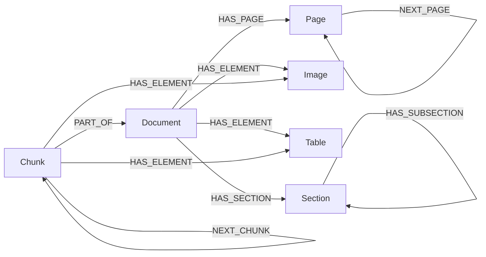

# mcp-neo4j-lexical-graph

MCP server for creating rich lexical graphs from PDF documents in Neo4j. Designed for Neo4j sales engineers to quickly build PDF-to-graph and GraphRAG agent chatbot POCs.

Supports PDF parsing strategies plus native Markdown, literal TXT, local HTML/XHTML
and DOCX ingestion, pluggable chunking, document versioning, optional visual descriptions,
and vector/fulltext search.

## Graph Model



Node types depend on the parse mode used. See [Parse Modes](#parse-modes) below.

## Parse Modes

| Mode | Nodes created | Best for |
|------|--------------|----------|
| `pymupdf` | Document, Chunk, Image, Table | General-purpose text + visual extraction |
| `docling` | Document, Page, Element, Section, (then Chunk via chunking tool) | Complex layouts, section-aware chunking |
| `page_image` | Document, Page | Slides/presentations for VLM-based extraction |

## Quick Start

```bash
cd mcp-neo4j-lexical-graph
uv sync --extra docling
```

### Cursor MCP Configuration

Add to your `.cursor/mcp.json`:

```json
{
  "mcpServers": {
    "neo4j-lexical-graph": {
      "command": "uv",
      "args": [
        "--directory",
        "/path/to/mcp-neo4j-lexical-graph",
        "run",
        "mcp-neo4j-lexical-graph"
      ],
      "env": {
        "NEO4J_URI": "bolt://localhost:7687",
        "NEO4J_USERNAME": "neo4j",
        "NEO4J_PASSWORD": "your-password",
        "NEO4J_DATABASE": "neo4j",
        "EMBEDDING_MODEL": "text-embedding-3-small",
        "EXTRACTION_MODEL": "gpt-6-luna",
        "OPENAI_API_KEY": "sk-..."
      }
    }
  }
}
```

## Markdown, TXT, HTML and DOCX

`create_lexical_graph` selects `document` mode automatically for `.md`, `.markdown`,
`.txt`, `.text`, `.html`, `.htm`, `.xhtml` and `.docx` (case-insensitive). A directory
may mix them with PDFs. Existing PDF parse-mode selection is preserved; `page_image` requires PDF input. Explicit `document` mode accepts only non-PDFs.

```python
create_lexical_graph(path="/absolute/path/reference.docx", output_dir="/absolute/path/outputs")
# Poll check_processing_status(job_id), then:
chunk_lexical_graph(document_id="returned-document-id", strategy="structured")
embed_chunks()
# Existing entity extraction and ontology workflows use the resulting Chunk nodes.
```

Markdown/HTML headings and DOCX heading styles produce native sections without an
LLM hierarchy step. TXT preserves literal characters/line endings and creates no
invented headings. Text files require UTF-8. Lists, tables and embedded DOCX images
are retained; linked resources are references rather than downloaded content.
HTML is static local content, with no JavaScript/browser execution.

Pageless documents store `Document.sourceFormat`, direct `HAS_ELEMENT` membership,
ordered elements and `Element.sourceAnchor`; chunks retain `sourceFormat` and
`sourceAnchors`. Page numbers/coordinates are absent. The reported zero source-page
count means no physical pagination was assigned. `by_page` falls back to token
windows in source order; `structured`/`by_section` retain native heading paths.
Verification reconstructs content directly from elements. PageIndex citations use
source anchors with null page fields. Vector/fulltext, schema-driven extraction,
CSV bridge merges, provenance and conflict policy use the existing pipeline.

Default IDs for new formats include their extension, so same-stem MD/DOCX files
remain separate sources. Ambiguous mixed-folder IDs are rejected before processing;
use explicit `document_id` values to intentionally select versioning identity.

Document replacement publishes the complete parsed lexical graph and switches its
active version in one transaction. A failed or cancelled write keeps the previous
version active and leaves no partial replacement graph. Schema constraints are
created first; chunking (except PyMuPDF's built-in chunks), embeddings and entity
extraction remain subsequent workflow steps. `set_active_version` switches the
requested document and optional existing chunk set together; an unknown chunk set
leaves the current selection unchanged.

## Tools

Tools must be called in a specific order — which tools to call depends on the parse mode and document type. See the workflow table below.

### Workflow Order

| # | Tool | pymupdf | docling | page_image | Notes |
|---|------|---------|---------|------------|-------|
| 1 | `create_lexical_graph` | ✓ | ✓ | ✓ | Always first. Async — returns job_id. |
| 2 | `check_processing_status` | ✓ | ✓ | ✓ | Poll until complete after any async op. |
| 3 | `cancel_job` | opt | opt | opt | Only if aborting a running job. |
| 4 | `chunk_lexical_graph` | ✗ | ✓ | ✓ | Required for docling/document/page_image. Integrated into create for pymupdf. |
| 5 | `list_documents` | ✓ | ✓ | ✓ | Confirm ingestion, get document IDs. |
| 6 | `verify_lexical_graph` | opt | opt | ✗ never | Single-doc spot-check only. Never for page_image (base64 flood). |
| 7 | `assign_section_hierarchy` | ✗ | correction only | ✗ | Docling supplies native levels; use this explicit correction only when needed. Uses EXTRACTION_MODEL unless levels are supplied. |
| 8 | `generate_chunk_descriptions` | recommended¹ | recommended¹ | **required** | VLM descriptions for Image/Table/Page nodes. Required before embed_chunks for page_image. |
| 9 | `embed_chunks` | ✓ | ✓ | ✓ | Synchronous. Call with no parameters — auto-detects textDescription. |
| 10 | `set_active_version` | opt | opt | opt | Only when re-ingesting a document. |
| 11 | `clean_inactive` | opt | opt | opt | After set_active_version, to remove old versions. |
| 12 | `delete_document` | opt | opt | opt | Destructive — removes document + all children. |

¹ Recommended when `extract_images=True` or `extract_tables=True` (pymupdf) or when the document contains images/tables (docling/document). Without descriptions, Image/Table nodes are invisible to semantic search.

Docling uses native heading hierarchy by default. With `strategy="structured"`,
chunks include the full heading chain; no separate hierarchy LLM call is required.
Flat documents remain valid. Review inferred levels on your own document before
relying on them for section-sensitive retrieval.

### Tool Reference

| Tool | Description |
|------|-------------|
| `create_lexical_graph` | Parse PDF(s) and create the graph (async, returns job_id). `max_parallel=0` auto-detects worker count from RAM/CPU. |
| `check_processing_status` | Monitor background job progress |
| `cancel_job` | Cancel a running background job (optional cleanup of partial data) |
| `chunk_lexical_graph` | Create Chunk nodes from Elements (4 strategies: token_window, structured, by_section, by_page) |
| `list_documents` | Inventory of documents with version and chunk count info |
| `verify_lexical_graph` | Structural checks + Markdown reconstruction (single-doc only) |
| `assign_section_hierarchy` | LLM-based section level assignment + rebuilds HAS_SUBSECTION + updates sectionContext on chunks. Omit `document_id` to run all active documents in parallel. |
| `generate_chunk_descriptions` | VLM descriptions for Image/Table/Page nodes — stored as textDescription. `document_id` optional: omit to run for all active documents. |
| `embed_chunks` | Vector embeddings + fulltext index. Auto-detects textDescription for unified Table/Image/text embedding. |
| `set_active_version` | Activate a specific document/chunk version |
| `clean_inactive` | Delete inactive document versions and chunk sets |
| `delete_document` | Remove a document version with cascade (pages, elements, sections, chunks) |

### Page-count contract

All public responses distinguish the physical PDF page count from the graph shape:

- `sourcePageCount` counts physical pages in the input PDF.
- `pageNodeCount` counts materialized Neo4j `:Page` nodes.
- Job status uses `sourcePagesExpected`, `sourcePagesProcessed`, and
  `currentFileSourcePageCount` because processing progress refers to input pages.

PyMuPDF currently writes chunks directly and intentionally creates no `:Page` nodes,
so a valid two-page PyMuPDF document reports `sourcePageCount: 2` and
`pageNodeCount: 0`. Docling and page-image currently materialize one `:Page` node per
source page. Unifying every parser behind `ParsedDocument` and one writer remains the
separate deferred `DOC-001` architecture task.

## Environment Variables

| Variable | Required | Default | Description |
|----------|----------|---------|-------------|
| `NEO4J_URI` | Yes | `bolt://localhost:7687` | Neo4j connection URI |
| `NEO4J_USERNAME` | Yes | `neo4j` | Neo4j username |
| `NEO4J_PASSWORD` | Yes | - | Neo4j password |
| `NEO4J_DATABASE` | No | `neo4j` | Database name |
| `EMBEDDING_MODEL` | No | `text-embedding-3-small` | Default embedding model ([LiteLLM providers](https://docs.litellm.ai/docs/embedding/supported_embedding)) |
| `EXTRACTION_MODEL` | No | `gpt-6-luna` | LLM/VLM for section hierarchy and description generation |
| `OPENAI_API_KEY` | Depends | - | Required when using OpenAI models for embedding or extraction. Other providers use their own key (e.g. `ANTHROPIC_API_KEY`, `AZURE_API_KEY`). See [LiteLLM docs](https://docs.litellm.ai/docs/providers) |

## Requirements

- **Neo4j with vector-index support** (compatibility tested on 5.26.33 and 2025.12.1; native vector values and filtered indexes are used when supported)
- **Python 3.10+**
- API key for your embedding provider (OpenAI, Azure, Cohere, Voyage, Ollama, etc.)
- API key for VLM for `generate_chunk_descriptions`, or `assign_section_hierarchy`


### Embedding cache identity and migrations

`embed_chunks` records `embeddingProvider`, `embeddingModel`, `embeddingDimensions`,
`embeddingInputHash`, and `embeddingSpace` beside each `text_embedding`. The input
hash covers the exact composed provider input, including ordered context and the
resolved text/visual-description fallback. Legacy vectors without identity are
regenerated; unchanged verified inputs skip provider work and still repair a missing
vector index. Unused raw text changes do not invalidate a preferred visual description.

`dimensions` optionally requests provider dimensions. Requested and actual dimensions
are validated; a fixed named index is never silently dropped or recreated. Explicit
incompatible dimensions fail before provider work. With provider-default dimensions,
an actual refresh response may be needed to discover incompatibility, but no separate
billable probe request is made. A model/dimension refresh cannot mix spaces with
unselected vectors in the same index. `include_inactive=true` includes inactive Chunk
nodes in a label-wide refresh when those also participate in the index.

A different label on the **same nodes is not separate vector storage**: this tool
always writes `text_embedding`. Space-changing writes refuse overlapping same-property
indexes; same-space refreshes validate their dimensions and recheck current node labels
under the publication lock. Use genuinely separate nodes/storage and indexes, or an
explicitly reviewed index migration. Hidden changes behind an unchanged remote model
alias cannot be detected from configuration alone: prefer versioned model identifiers,
or explicitly refresh the whole indexed label when an alias is retargeted.

Vector values and identity metadata publish atomically after source-input and vector-space
rechecks. A partial/invalid provider response or changed source aborts publication.
The tool needs `SHOW CONSTRAINT` to inspect the reserved uniqueness constraint
`neo4j_mcp_embedding_lock_unique`. If it is absent, an administrator can precreate it
on `:EmbeddingPublicationLock(indexName)`, or grant `CREATE CONSTRAINT` to the runtime
role. Graph read/write, name and index privileges are also required; these constraint
checks happen before provider requests. A temporary
per-index lock node is removed on commit or rollback. No constraint/index is automatically
dropped. The uniqueness constraint and an empty verified vector index may remain when a
later provider/source check aborts: those schema side effects are separate from atomic
vector/metadata publication. Large-run memory bounds remain separate performance work.
