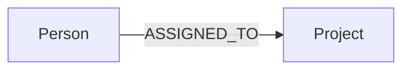

# Graph Report — Contract Test

## Source Data

- `assignments.pdf` — PDF, 4 chunks

## Use Cases

Count assignments by role.

## Graph Data Model



## Cypher Queries

### Use case: Count assignments by role

```cypher
MATCH ()-[r:ASSIGNED_TO]->()
RETURN r.role, count(*) AS assignments
```

**Results**: Architect 1; reviewer 1.
**Coverage**: Full

## Extraction Quality

Two entities and two source links were verified with no duplicates.

## Gaps and Limitations

The fixture contains one project.

## Recommended Next Steps

Test with more projects.
