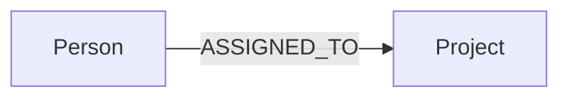

# Chatbot Report — Contract Test

## Source Data

- `people.csv` — CSV, 2 records

## Use Case

Help reviewers understand project assignments.

## Graph Data Model

## Target Questions and Answers

### Q1: Who is assigned to the project?

- **Method**: cypher
- **Query**: `MATCH (p:Person)-[:ASSIGNED_TO]->(project) RETURN p.name`
- **Answer**: Ada Lovelace and Grace Hopper.
- **Quality**: Complete
- **Improvement**: Add assignment dates.

### Q2: What roles do they have?

- **Method**: cypher
- **Query**: `MATCH ()-[r:ASSIGNED_TO]->() RETURN r.role`
- **Answer**: Architect and reviewer.
- **Quality**: Complete
- **Improvement**: Add role descriptions.

## Gaps and Limitations

The fixture has no assignment dates.

## Recommended Next Steps

Add assignment dates to the source data.
